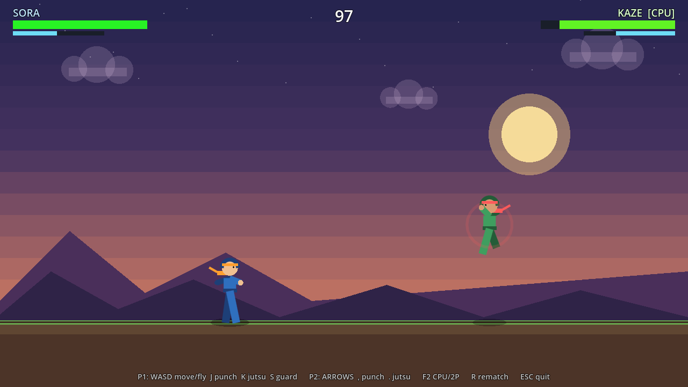

# 忍者风暴竞技场（Ninja Storm Arena）

用 Godot 4 做的 2D 空中格斗游戏：主菜单、角色选择、八方向空中移动、气槽、气功弹、近身连段、防御格挡、替身和奥义。角色与素材完全原创（SORA / KAZE）。



## 怎么运行

**最省事的方式：双击 `开始游戏.command`。** 第一次运行 macOS 会问是否允许访问「文稿」文件夹，点允许即可。

想改东西就双击 `打开Godot编辑器.command`，在编辑器里按 F5。

命令行方式（开发时使用 Godot 4.7.2）：

```bash
cd /path/to/游戏开发
/opt/homebrew/bin/godot --path .
```

如果换台机器，先装 **Godot 4.7 或更新版本**：<https://godotengine.org/download/macos>（Apple Silicon 选 macOS Universal），或 `brew install --cask godot`。

> 启动脚本使用 Homebrew 的 Godot 入口，避免 macOS 把项目重新交给编辑器；双击后会直接进入游戏窗口。

## 操作

**P1（键盘）**

- `A / D`：左右移动（地面跑动、空中漂移）
- `W`：跳跃；空中按住持续升空（消耗气）
- `S`：地面防御格挡；空中按住 = 急速下落
- `J`：攻击（地面连按三次出三段连击，第三段吹飞；空中为单段空击）
- `K`：忍术气弹（消耗气）
- `L`：1 号技能（突进）
- `I`：2 号技能（挑空）
- `U`：超必杀·裂空斩（消耗 60 气，冷却 5 秒）
- `Q`：替身术（受击硬直中使用，消耗 28 气，冷却 3 秒，短暂无敌并瞬移脱身）

**P2（键盘，双人模式）**

- `← / →`：左右移动；`↑` 跳跃/升空；`↓` 防御/下落
- `,`：攻击；`.`：忍术气弹；`/`：1 号技能；`;`：2 号技能；`K`：超必杀；`右 Shift`：替身术

**手柄**：P1 = 1 号手柄，P2 = 2 号手柄。A 攻击 / B 忍术 / X 跳跃 / Y 防御，摇杆或十字键移动。

**朝向是自动的**：不用按转身键，角色永远面朝对手；只有出招过程中会锁定朝向，避免挥到一半转身。

**全局**

- `F2`：把 KAZE 在 CPU 与双人模式间切换（开局默认 CPU）
- `P`：暂停 / 继续（暂停时战斗、倒计时和音效都会停住）
- `R`：重新开始本局；KO 后按 `R` 或 `Enter` 再来一局
- `ESC`：战斗中回主菜单；主菜单中退出

## 规则

- 双方各 100 HP、100 气，气会缓慢回复，命中对方额外回气
- 防御可以大幅减伤并挡住击退；但防御只能在地面架起，空中按防御键是快速下落
- 一局 99 秒，KO 即胜；时间到则按剩余 HP 判定
- 命中带有短暂的 Hit-Stop（顿帧）和镜头震动

## 代码结构

```text
project.godot          项目配置（1280x720、60 物理帧，渲染也锁在 60，见「性能」）
scenes/main.tscn       入口场景
scripts/
  main.gd              对战流程、HUD、顿帧/震屏、特效调度
  fighter.gd           角色状态机：待机/跑动/空中/攻击/受击/防御/KO
  orb.gd               忍术气弹
  skill_db.gd          读取生成好的技能配置（唯一读配置的地方）
  input_setup.gd       键盘+手柄输入映射（代码注册，方便改键）
  bg.gd                火影村黄昏背景、落叶和前景压暗
  fx.gd                命中特效
  sfx.gd               音频运行时：播放池、立体声定位、变调、音乐闪避、限幅
data/skills/
  kaze.json            策划改这个：KAZE 的数值、招式、技能槽（改完要重新生成）
  sora.json            同上，另一个角色
data/characters.generated.json   由 tools/skills_build.py 生成的产物，游戏只读它
docs/skills.md         技能配置手册：每个字段什么意思、帧优势怎么算
docs/reference_review.md  外部美术资源与开源项目评估、授权边界和落地顺序
docs/asset_sources.md  当前素材来源登记和外部资源引入检查清单
tools/
  dsp.py               合成原语（滤波、共振扫频、混响、循环交叉淡化）
  build_audio.py       渲染全部 20 个音效，并把混音解到音色规格上
  build_music.py       渲染战斗循环 BGM 与结算长音
  gen_voices.py        用 TTS 生成日语喊话，并用语音识别验证
  audio_report.py      按频谱门限体检整套音色，不达标即失败
  audio_preview.py     生成试听文件（A/B 对比、逐条带报名的清单）
  godot_reimport.py    刷新 Godot 的导入缓存（改完素材必须做）
  skills_build.py      校验 data/skills/*.json、生成配置、打印帧数据表
tests/smoke.gd         无头冒烟测试
tests/menu_flow.gd     TDD 回归：主菜单 → 选人 → KO → 再战 → 主菜单
tests/skills_check.gd  技能管线测试：配置 → 场上的角色，含 CPU 真的用了配置的技能
tests/audio_check.gd   音频接线测试：素材齐全、导入不陈旧、事件真的会响
tests/perf.gd          帧时间探针：跑一局，报告帧率、卡顿点、每渲染帧的物理步数
tests/_perf_hot.gd     perf.gd 的搭档：关掉垂直同步量真实开销，并统计帧节奏
docs/preview.png       运行画面预览
```

## 技能配置（改数值请走这条路）

招式不写在代码里。**一个角色一个 JSON**，策划改数值、程序不动刀：

```text
data/skills/<角色>.json  →  python3 tools/skills_build.py  →  data/characters.generated.json  →  游戏启动时加载
```

```bash
python3 tools/skills_build.py          # 校验 + 生成 + 打印帧数据表（含命中/防御帧优势）
python3 tools/skills_build.py --check  # 只校验：忘了重新生成会在这里失败
```

「一招」的完整字段——启动/活跃/收招帧、判定框、伤害、硬直、击退、顿帧、取消窗口、
耗气冷却、空中能不能出、CPU 的使用距离和权重——都在 [docs/skills.md](docs/skills.md) 里。
核心规矩是**动画和判定分离**：判定框是数据，动画只是表现；帧优势（命中/防御）由工具直接算给你看，
调平衡时对着那张表改。

改坏了不会带进游戏：姿势名、音效名、id 拼错、连段接不上、槽位空着……`skills_build.py`
会在生成之前报错，不让半成品配置进游戏。

## 音频

音效和 BGM 全部由代码合成，语音由 TTS 生成，所以仓库里没有任何采样或授权音频。素材在 `assets/audio/`，但**真正的源文件是 `tools/` 里的脚本**——听感不对就改脚本重渲染，不要手改 wav。

> 音效的打击层来自 `tools/foley/` 里的 CC0 公共领域录音（Kenney 等，来源记录在 `tools/foley/manifest.json`）。
> 用 `python3 tools/foley.py --verify` 可以核对许可证与清单。仓库已包含这份素材，重新构建不需要联网。

```bash
python3 tools/build_audio.py       # 音效（约 2 分钟，末尾自动重新导入）
python3 tools/build_music.py       # BGM
python3 tools/gen_voices.py --install --verify   # 日语喊话（联网）
python3 tools/audio_report.py      # 频谱体检：20 个音效 + 6 条语音
python3 tools/audio_preview.py --board           # 逐条带报名的试听清单
```

**语音和美术生成需要 ZenMux API key**（普通运行游戏、重渲染音效/音乐都不需要）。任选一种方式提供：

```bash
export ZENMUX_API_KEY="你的 key"     # 环境变量
echo "你的 key" > tools/.zenmux_key   # 或写进本地文件（已被 .gitignore 忽略）
```

没有 key 时脚本会明确报错，不会把密钥写进仓库。

**重要：渲染完必须重新导入。** Godot 只在编辑器里重新导入素材，用命令行直接跑游戏时读的是 `.godot/imported/` 里的旧副本。旧版本的声音改了却听不出变化，就是因为缓存里还是上一版音效。`tools/build_audio.py` 等脚本现在会自动调用 `tools/godot_reimport.py`；万一漏了，`tests/audio_check.gd` 会直接报 `stale: ...` 并失败。

试听文件：

- `docs/audio_ab.wav` — 前 3.9 秒是改造前运行时现场合成的五个音，后面是现在真正在用的整套音色（含 BGM 与喊话）
- `docs/audio_board.wav` — 每一条音效/语音单独播一遍，前面用人声报出名字，方便指出具体哪一条不对

## 自动测试

无头模式让双方 AI 自动打完一整局，正常应输出 `SMOKE OK` 并返回退出码 0：

```bash
godot --headless --fixed-fps 60 --path . -s res://tests/smoke.gd
godot --headless --path . -s res://tests/skills_check.gd
godot --headless --path . -s res://tests/audio_check.gd
python3 tools/skills_build.py --check
python3 tools/audio_report.py
```

`skills_check.gd` 是技能管线的守门人：确认配置真的被加载（不是内置兜底）、每个技能键按下去出的是
配置里的那招、场上的血量/气量/判定框尺寸来自配置、自动朝向会在对手换边后转身、
CPU 只在自己招式的使用距离窗口内出招，并且一整局打下来真的用到了配置的技能槽。

`audio_check.gd` 覆盖素材是否齐全、导入是否陈旧、每个事件是否真的会启动播放器、语音冷却是否生效、旧事件名是否仍能解析，以及一整局 AI 对战是否会用到大部分音色。

## 性能

**渲染锁在 60，和物理同频，这是故意的，别当成可以顺手优化掉的限制。**

角色位置只在物理帧（60 Hz）更新，中间没有插值。渲染比 60 快不会让画面更顺，
只会把同一个状态重复画给好几个渲染帧：120 Hz 屏上实测有一半的渲染帧"物理步数 = 0"，
角色移动时 59% 的帧和前一帧坐标完全一样，而且重复的帧数在 2 和 3 之间乱跳，
看起来就是一顿一顿。锁成 60 之后每渲染帧恰好推进一步，节奏完全均匀。

这不是"跑不动"——**游戏本身很轻**：关掉垂直同步量下来，全开只要 4.55 ms 一帧（220 FPS），
把角色、HUD、背景、音效分别藏掉，帧时间差值都在 0.3 ms 以内。所以别再往"优化绘制"上使劲了。

想改成真 120 Hz 顺滑，得升到 Godot 4.4+ 并打开 `physics/common/physics_interpolation`
（4.3 没有这个功能），或者自己写物理插值，两种情况都要重跑下面两个探针确认节奏。

**换帧率相关的东西之后，跑这两个探针**（要开窗口，不能 `--headless`）：

```bash
godot --path . -s res://tests/perf.gd      -- base   # 出厂配置，玩家实际看到的样子
godot --path . -s res://tests/_perf_hot.gd -- default
godot --path . -s res://tests/_perf_hot.gd -- raw    # 关掉垂直同步，量真实开销
```

健康的标准是：`每渲染帧的物理步数` 全是 1 步、`两次物理步之间的渲染帧数` 全是"隔 1 帧"。

**另一条规矩：装饰性代码不许用全局随机数。** 全局 `randf()` 流是给玩法用的（CPU 选招、
音效变调），它必须只按物理帧被抽。镜头抖动和落叶回绕这类纯好看的东西各有自己的
`RandomNumberGenerator`（见 `main.gd` 的 `_shake_rng`、`bg.gd` 的 `_rng`）——
否则帧率一变，CPU 打出来的拳都会变。同理，测试里 `seed()` 必须在 `Main._ready()`
跑完之后再调一次，因为 `_ready()` 里的 `randomize()` 会把它冲掉。

## 想继续做完整版？Godot 4 建议掌握这些

- GDScript、场景/节点树、信号（本项目的状态机就是现成示例）
- CharacterBody2D / Area2D、物理层与碰撞体（本作命中判定目前是几何矩形）
- AnimationPlayer、Tween、AnimatedSprite2D（动画系统，替换现在的“代码小人”）
- Camera2D、CanvasLayer、UI（HUD 已示范）
- 输入映射与手柄（InputMap 已示范）
- 音频合成/播放与素材导入（音效已示范）
- 导出与打包：正式发布需要下载 Export Templates

现在已经具备完整的一局对战闭环；后续可以继续加角色选择、更多忍者和联网对战。

## 许可证

代码与项目原创素材采用 [MIT License](LICENSE)。音效中的打击层使用 CC0 公共领域录音，
来源见 `tools/foley/manifest.json`；第三方素材各自的许可证不因本项目的 MIT 许可证而改变。
